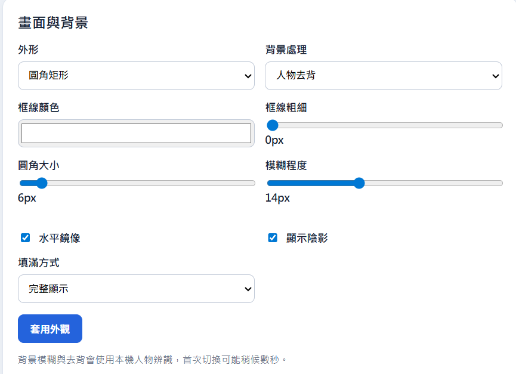

# Windows 雙攝影機浮動顯示工具

免安裝、可攜式的 Windows 雙攝影機浮動顯示工具。解壓縮後即可執行，不需要安裝驅動程式或背景服務。

## v0.3.2 去背模型全面更新

[下載 v0.3.2 免安裝版（Windows EXE）](https://github.com/harmonica80/WebcamOverlay/releases/download/v0.3.2/WebcamOverlay-Portable-0.3.2.exe) · [版本說明與 SHA-256 校驗碼](https://github.com/harmonica80/WebcamOverlay/releases/tag/v0.3.2)

關閉舊版後，將新版 EXE 放在原資料夾執行，並保留旁邊的 Data 資料夾。

- **影片去背（RVM，預設）**：Robust Video Matting 專為網路攝影機設計，跨影格保留狀態，閃爍少、髮絲與手指完整，並以模型預測的前景色去除邊緣殘留的背景色。
- **四種去背模式**：影片去背（RVM）、進階（PP-MattingV2）、品質（MediaPipe 多類別）、快速。需要 WebGPU 的模式無法使用時，自動改用品質模式並顯示提示。
- **GPU 邊緣修整**：所有模式都以攝影機畫面為導引，在 GPU 上把遮罩放大到畫面解析度，並加上動作感知防閃爍。
- **更小的程式**：PP-MattingV2 改用 FP16、裝飾圖改用 WebP、移除舊版 MediaPipe 與重複檔案。
- **授權變更**：因包含 GPL-3.0 的 RVM，程式碼改以 GPL-3.0 釋出；詳見 [LICENSE](LICENSE) 與 [THIRD_PARTY_NOTICES.md](THIRD_PARTY_NOTICES.md)。

舊版本說明請見 [CHANGELOG.md](CHANGELOG.md)。

## 功能總覽

### 攝影機來源

- 掃描 Windows 可用的攝影機裝置。
- 最多指定兩個不同的攝影機來源。
- 顯示一個畫面時，點擊畫面可在兩個來源間切換。
- 顯示兩個畫面時，點擊任一畫面可交換兩個來源。
- 隱藏的攝影機會釋放裝置，避免切換時互相占用。
- 攝影機中斷時顯示提示，並自動嘗試重新連線。

### 浮動視窗

- 隱藏、顯示一個、顯示兩個三種狀態。
- 無標題列，可拖曳到任意螢幕。
- 支援多螢幕與不同解析度／DPI。
- 永遠置頂顯示，切換到其他程式後仍保持顯示。
- 滑鼠滾輪平滑縮放，維持正確畫面比例。
- 勾選記錄設定後，記住每個視窗的位置與大小。

### 畫面外觀

- 矩形、圓角矩形、圓形外形。
- 白色、黑色、藍色及自訂框線顏色。
- 框線粗細可調整，預設 5 px。
- 圓角大小可調整，預設 20 px。
- 陰影開關。
- 圓形模式使用真正的圓形裁切，避免出現方形外露。
- 水平鏡像可自行開啟，預設為關閉。

### 快速排列

- 可折疊為僅顯示標題列，並能保持置頂。
- 單一攝影機提供九宮格位置，雙攝影機提供六種快速排列。
- 排列模式與攝影機選單採用視窗內選項，避免置頂狀態下選項自動關閉。

### 背景處理

- 原有背景。
- 背景模糊，可調整模糊程度。
- 人物去背，背景以透明方式顯示，可看見後方視窗。
- 虛擬背景：內建照片、純色或自訂圖片。
- 去背模式：影片去背（RVM）、進階（PP-MattingV2）、品質（MediaPipe 多類別）、快速。
- 所有模型隨程式封裝、離線執行，攝影機影像不會離開電腦。
- RVM 與進階模式需要支援 WebGPU 與 FP16 的顯示卡（近年 NVIDIA、AMD、Intel 內顯多可支援）。

### 快速鍵

- 循環切換隱藏／一個／兩個畫面。
- 直接隱藏、顯示一個或顯示兩個畫面。
- 交換攝影機來源。
- 快速鍵可在設定頁點選按鍵方塊後直接錄製。
- 僅使用 Windows 按鍵格式，例如 `Ctrl`、`Alt`、`Shift`、`F8`。
- 儲存時檢查格式及是否與其他程式衝突。

### 系統整合與設定

- 系統匣圖示與右鍵選單。
- 從系統匣快速開啟設定、切換顯示狀態、交換來源或結束程式。
- 外觀與攝影機設定即時套用。
- 設定保存於可攜版 EXE 旁的 `Data\settings.json`，可隨整個資料夾搬移。
- 預設不保存使用設定。勾選視窗下方的記錄選項後，攝影機來源、顯示狀態、個別外觀、快速鍵及視窗位置才會自動保存並於下次啟動套用。
- 設定視窗底部可將所有設定重設為預設值，執行前會再次確認。
- 設定頁底部提供「述文老師學習網開發」連結。
- 使用標準 PNG 應用程式與系統匣圖示。

## 設定畫面



## 使用方式

1. 下載並執行免安裝 EXE。
2. 在設定頁按「重新偵測」，選擇來源 1 與來源 2。
3. 選擇顯示狀態及外觀、背景效果。
4. 關閉設定頁後，使用浮動視窗、系統匣或自訂快速鍵操作。

## 開發與建置

```powershell
npm.cmd install            # 也會複製執行檔案並下載品質模式模型
npm.cmd start
npm.cmd test               # 回歸測試
npm.cmd run build:portable # 產生 release\WebcamOverlay-Portable-<版本>.exe
```

- `scripts/sync-vendor.js`：從 node_modules 複製 ONNX Runtime 與 MediaPipe Tasks 執行檔到 `src/vendor`。
- `scripts/fetch-models.js`：下載 selfie multiclass 模型（Google 官方網址）並核對 SHA-256；建置時必須成功，`npm install` 時失敗只會提示。
- `npx electron scripts/verify-matting-electron.js`：以合成攝影機實際執行所有去背模式，輸出到 `release/matte-qa`。沒有 GPU 的環境可加上環境變數 `WEBCAM_QA_CPU=1`。

模型來源與轉換：

| 檔案 | 來源 | 處理 |
|---|---|---|
| `vendor/rvm/rvm_mobilenetv3_webgpu.onnx` | RobustVideoMatting v1.0.0 官方 FP32 ONNX | 以 `scripts/patch-rvm-model.py` 將通道數補齊為 4 的倍數，避開 ONNX Runtime WebGPU 卷積錯誤；結果與原模型相同 |
| `vendor/ppmatting/ppmattingv2_fp16.onnx` | v0.2.34 修正後的 PP-MattingV2 ONNX | 移除 Resize 空輸入後轉 FP16（輸入輸出維持 FP32），與 FP32 最大透明度差 0.03 |
| `vendor/mediapipe/selfie_segmentation*.tflite` | 原本隨程式附帶的 MediaPipe 模型 | 以 tflite-support 加入 Tasks API 需要的正規化 metadata（mean 0、std 255） |
| `vendor/mediapipe/selfie_multiclass_256x256.tflite` | Google MediaPipe 官方 | 由 `fetch-models.js` 下載 |

專案原始碼位於 [GitHub WebcamOverlay](https://github.com/harmonica80/WebcamOverlay)。
